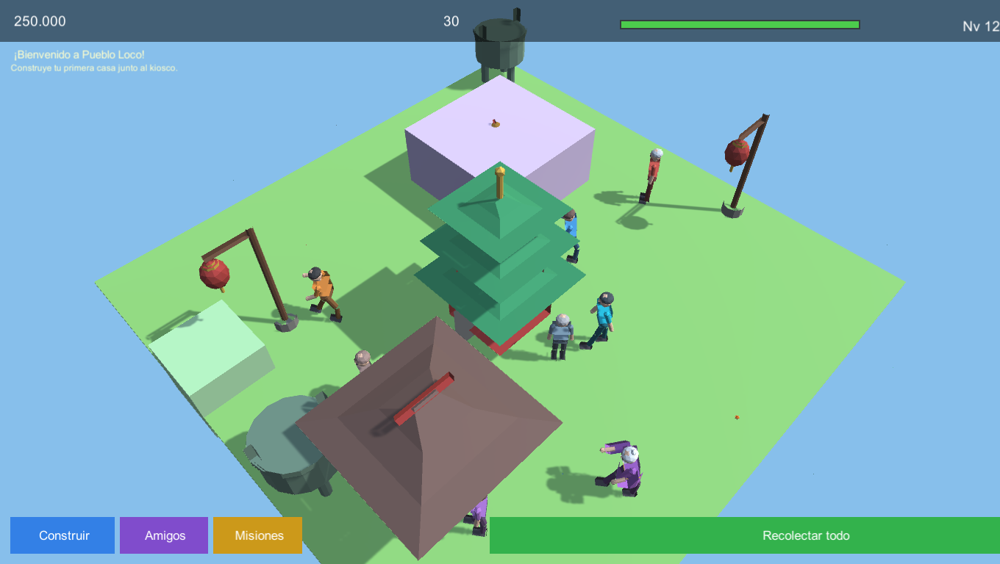
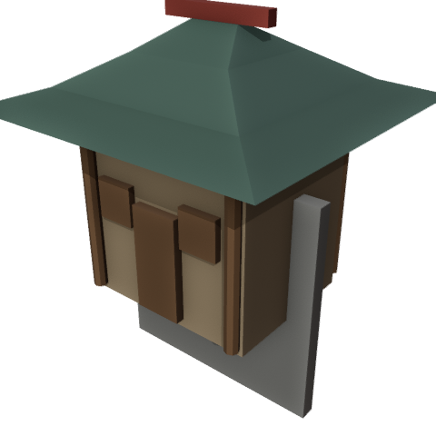
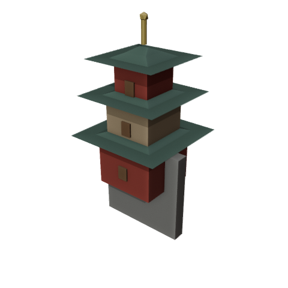
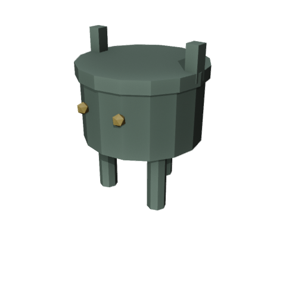
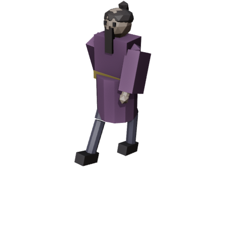
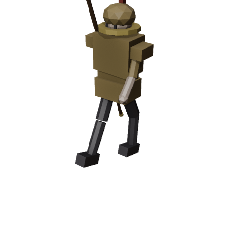
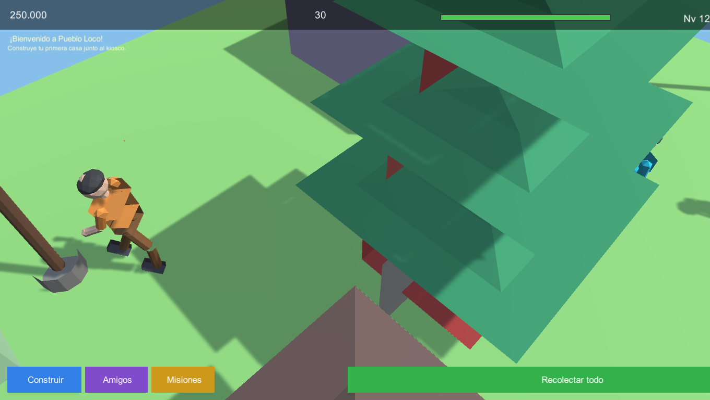

# Pueblo Loco (Unity)

Versión **Unity 3D** de [Pueblo Loco](https://github.com/traderxael/pueblo-loco): un juego
de construcción de barrio con vecinos, tareas, misiones y monedas.

Esta versión suma **personajes con esqueleto y animaciones hechas en Blender**, vecinos que
caminan solos por el pueblo y varias correcciones de render del proyecto original.


## Novedades de esta versión

### Personajes con esqueleto y animaciones (Blender)

- 3 modelos riggeados generados por script en Blender: **Villager** (adulto), **Kid** (nene)
  y **Elder** (abuelo).
- Cada uno con **armature de 20 huesos** (raíz, caderas, columna, pecho, cuello, cabeza,
  hombros, brazos con codo, manos, piernas con rodilla y pies) y *skinning* rígido por partes.
- **5 animaciones por personaje**, exportadas en el mismo FBX como takes separados:
  `Idle`, `Walk`, `Run`, `Work`, `Wave`.

| Idle | Walk | Work | Wave |
|---|---|---|---|
|  |  |  |  |

- **VillagerManager** instancia a todos los vecinos desbloqueados y les pinta ropa/pelo/piel
  con los colores del catálogo (cada personaje se ve distinto).
- **VillagerAI**: máquina de estados Idle → Walk → Work que camina por el terreno libre,
  esquiva edificios, va a trabajar cuando tiene una tarea activa y saluda si lo tocás.
- **Animator Controllers** generados por editor script con parámetros `Speed`, `Working` y
  `Wave` y transiciones Idle/Walk/Run/Work/Wave.

### Tema "China antigua" (Canva → Blender → Unity)

A partir de la presentación sobre las dinastías Xia, Shang y Zhou hecha en **Canva**
(carpeta `pueblo loco`), se modelaron assets nuevos en Blender y se integraron al juego:

- **5 assets nuevos** generados por script (`Tools/Blender/build_china_assets.py`):
  `CasaHan` (casa con techo curvo), `Pagoda` (tres cuerpos), `Ding` (vasija ritual de bronce),
  `FarolHan` (farol rojo) y `Puerta` (paifang).
- **2 personajes nuevos riggeados**: **Sabio Chen** (túnica, rodete y barba) y **Guardia Wu**
  (armadura, casco y lanza que se mueve con la mano), con **20 huesos y las 5 animaciones**
  (`Idle`, `Walk`, `Run`, `Work`, `Wave`).
- **Edificios nuevos** en el catálogo: **Casa Han** (900 monedas) y **Pagoda del Dragón** (6000).
- **Vecinos nuevos desbloqueables** con tareas propias: "Estudiar los clásicos",
  "Meditar en el jardín", "Patrullar el pueblo" y "Entrenar con la lanza".
- **Decoración**: faroles y vasijas de bronce como adornos colocables.
- Las partidas viejas **migran solas**: `SaveSystem.EnsureCharacters` agrega los personajes
  nuevos al guardado existente.



| Casa Han | Pagoda | Vasija de bronce |
|---|---|---|
|  |  |  |

| Sabio Chen | Guardia Wu | Detalle en el juego |
|---|---|---|
|  |  |  |

### Correcciones del proyecto original

- **Terreno y edificios acostados**: los FBX traen una rotación de -90° en la raíz que
  `Instantiate(..., Quaternion.identity)` borraba. Ahora se conserva y el pueblo se ve derecho.
- **Edificios con cubo de reemplazo**: se cargaban con minúscula (`"casa"`) y los FBX se llaman
  `Casa.fbx`; ahora se mapean bien y aparecen los modelos reales.
- **Sobre-exposición**: se bajó la luz solar y el ambiente, y se activaron sombras suaves.
- **HUD superpuesto**: la barra de XP y el texto de nivel se pisaban, y la misión tapaba el
  panel superior. Reubicados.
- **Aparición de edificios** con animación de rebote (PopIn).

## Cómo jugar

| Acción | Control |
|---|---|
| Mover cámara | `WASD` / flechas (o arrastrar con un dedo) |
| Zoom | rueda del mouse / pinza de dos dedos |
| Construir | botón **Construir** → elegir edificio → click en el terreno |
| Recolectar | click en la burbuja de monedas de cada edificio, o **Recolectar todo** |
| Amigos / tareas | botón **Amigos** (o click sobre un vecino) |
| Misiones | botón **Misiones** |

## Cómo abrir el proyecto

1. Abrir esta carpeta con **Unity 6000.6.5f1** (Unity Hub → Add project).
2. Abrir `Assets/Scenes/Main.unity` y darle Play.
   La escena puede estar vacía: todo se construye por código desde `Bootstrap`.

Build de Windows (batch):

```powershell
& "C:\Program Files\Unity\Hub\Editor\6000.6.5f1\Editor\Unity.exe" `
  -batchmode -projectPath "C:\ruta\pueblo-loco-unity" `
  -executeMethod PuebloLoco.EditorTools.CharacterPipeline.BuildCI `
  -logFile build.log
```

El ejecutable queda en `Build/PuebloLoco.exe`.

## Pipeline de arte (Blender)

Los personajes se generan **100% por código** con Blender headless:

```powershell
& "tools\blender-5.2.2-windows-x64\blender.exe" --background --factory-startup --offline-mode `
  --python "Tools\Blender\build_characters.py"
```

El script construye malla + armature + skinning + las 5 animaciones, exporta los FBX a
`Assets/Resources/Characters/` y renderiza previews de control en `Tools/Blender/previews/`.

> Nota: Blender escribe en `pueblo_stage/` (staging) porque en esta máquina corre con
> permisos restringidos; después se copian los FBX al proyecto.

## Estructura

```
Assets/
  Art/Characters/            FBX originales de los personajes
  Resources/Characters/      FBX que carga el juego en runtime
  Resources/Animations/      Animator Controllers generados
  Scripts/
    Gameplay/VillagerAI.cs      comportamiento de los vecinos
    Gameplay/VillagerManager.cs spawn + pintado + animator
    Gameplay/CharacterView.cs   click → saludo + menú Amigos
    Gameplay/GridBuildSystem.cs grilla, edificios, tintes
    Dev/DevCapture.cs           modo capturas (-shotdir)
  Editor/CharacterPipeline.cs import settings + controllers + build
Tools/Blender/build_characters.py   generador de personajes
docs/                               capturas para el README
```

### Modo captura

```
Build\PuebloLoco.exe -shotdir "C:\ruta\shots" -screen-width 1360 -screen-height 768
```

Arma un pueblo de ejemplo, deja a los vecinos animados y guarda 6 PNGs.

## Créditos

- Juego original (web): [traderxael/pueblo-loco](https://github.com/traderxael/pueblo-loco)
- Personajes, esqueletos y animaciones: generados con Blender 5.2.2 (script incluido)
- Motor: Unity 6000.6.5f1
