# Pueblo Loco (Unity)

Versión **Unity 3D** de [Pueblo Loco](https://github.com/traderxael/pueblo-loco): un juego
de construcción de barrio con vecinos, tareas, misiones y monedas.

Esta versión suma **personajes con esqueleto y animaciones hechas en Blender**, vecinos que
caminan solos por el pueblo y varias correcciones de render del proyecto original.

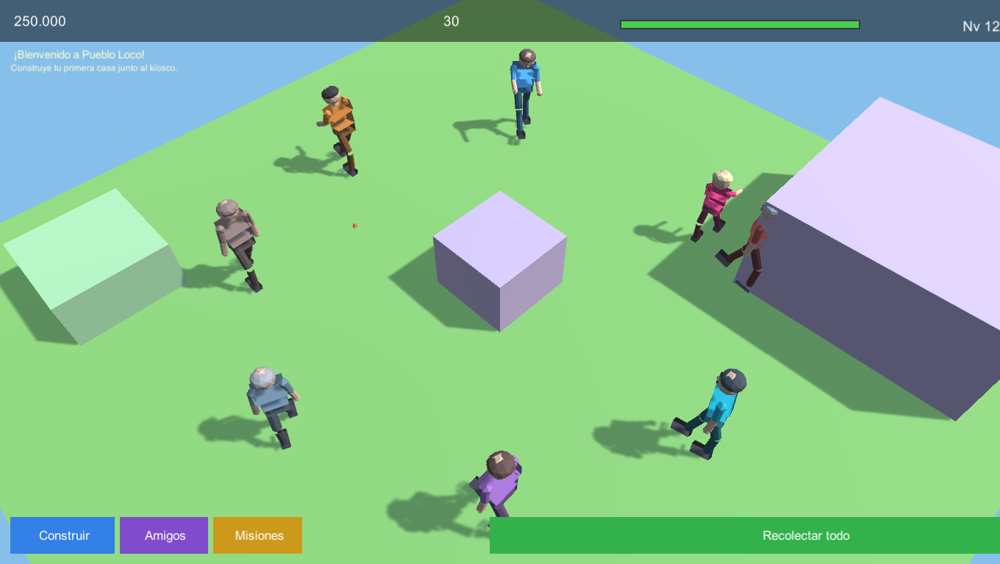

## Novedades de esta versión

### Personajes con esqueleto y animaciones (Blender)

- 3 modelos riggeados generados por script en Blender: **Villager** (adulto), **Kid** (nene)
  y **Elder** (abuelo).
- Cada uno con **armature de 20 huesos** (raíz, caderas, columna, pecho, cuello, cabeza,
  hombros, brazos con codo, manos, piernas con rodilla y pies) y *skinning* rígido por partes.
- **5 animaciones por personaje**, exportadas en el mismo FBX como takes separados:
  `Idle`, `Walk`, `Run`, `Work`, `Wave`.

| Idle | Walk | Work | Wave |
|---|---|---|---|
| 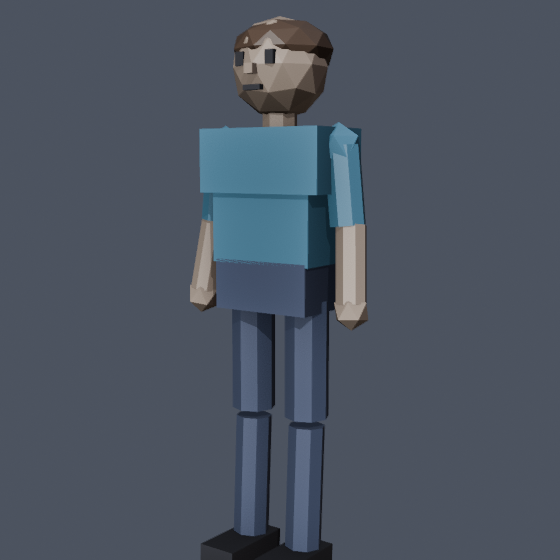 | 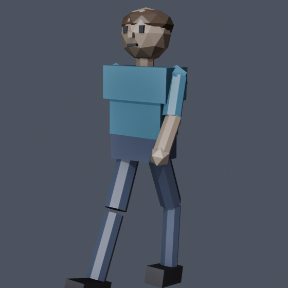 | 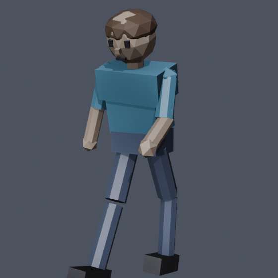 | 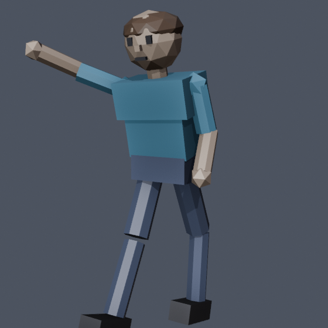 |

- **VillagerManager** instancia a todos los vecinos desbloqueados y les pinta ropa/pelo/piel
  con los colores del catálogo (cada personaje se ve distinto).
- **VillagerAI**: máquina de estados Idle → Walk → Work que camina por el terreno libre,
  esquiva edificios, va a trabajar cuando tiene una tarea activa y saluda si lo tocás.
- **Animator Controllers** generados por editor script con parámetros `Speed`, `Working` y
  `Wave` y transiciones Idle/Walk/Run/Work/Wave.

### Tema "China antigua" (Canva → Blender → Unity)

A partir de la presentación sobre las dinastías Xia, Shang y Zhou hecha en **Canva**
(carpeta `pueblo loco`), se modelaron los assets en Blender y se integraron al juego.

**Rediseño v2** (siguiendo el prompt maestro de ciudad china, estilo Tang/Ming):

- Paleta del prompt: rojo laca `#B33B2E`, dorado `#D9A441`, verde jade `#3E7C59`,
  madera oscura `#4A3728`, techo azul-gris `#37474F` y blanco cal `#EDE6D6`.
- **Techos** con perfil curvo, aleros levantados, tabla de alero, caballete y remates.
- **Dougong** (ménsulas entrelazadas) bajo cada alero.
- **Celosías geométricas** en puertas y ventanas, studs dorados, farolillos,
  banderolas y **leones guardianes** en la entrada.
- **Pagoda de 5 pisos** con balcones, barandas, pináculo de aros dorados y farolillos.
- **Paifang** (puerta ceremonial) con tres techos y banderolas.
- Assets con nomenclatura **SM_/SK_** e `index.json` con tris, huesos y animaciones
  (`docs/assets-china-index.json`).

| Casa Han | Pagoda 5 pisos | Paifang |
|---|---|---|
| 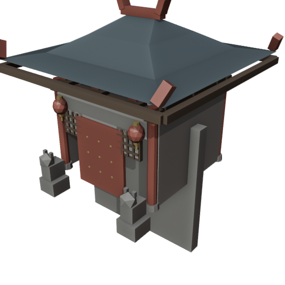 | 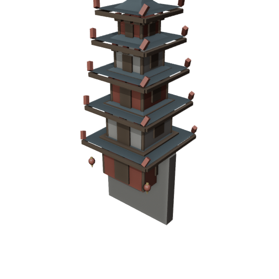 | 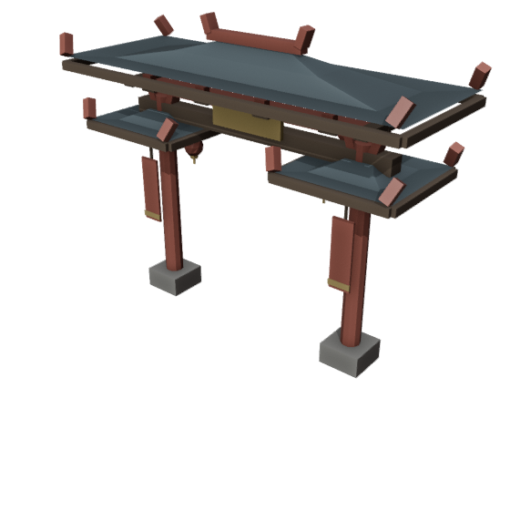 |

| Vasija ding | Farol | Sabio Chen | Guardia Wu |
|---|---|---|---|
| 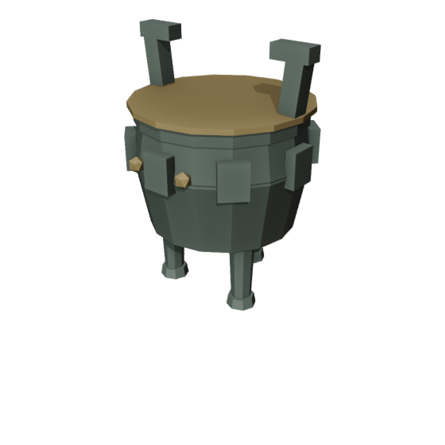 | 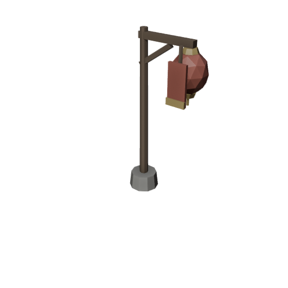 | 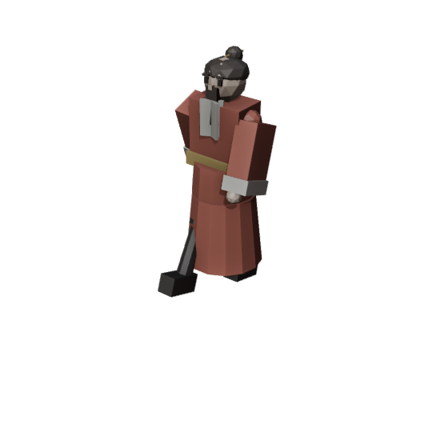 | 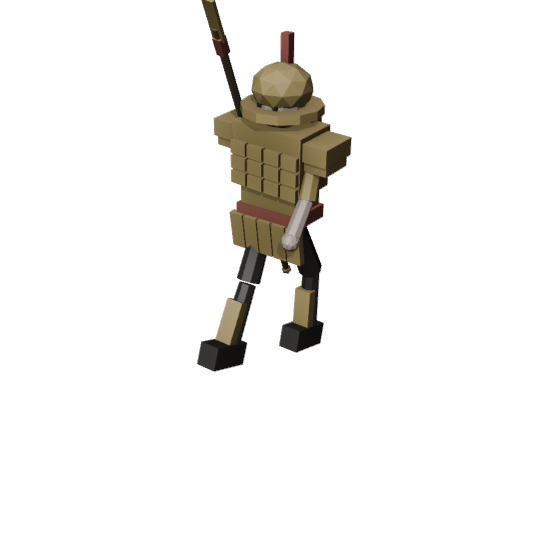 |

**Personajes** (`SK_Sabio`, `SK_Guardia`):

- **22 huesos con nombres del rig Humanoid de Unity** (`Hips`, `Spine`, `Chest`,
  `Head`, `LeftUpperArm`, `LeftLowerLeg`, `LeftToes`, ...), listos para mapear a
  avatar Humanoid.
- **8 animaciones** cada uno: `Idle`, `Walk`, `Run`, `Work`, `Wave`, `Bow`, `Cheer`, `Gather`.
- Sabio: túnica en capas, solapas cruzadas, faja con jade, rodete con pasador y barba.
- Guardia: armadura lamelar, hombreras, casco con cresta, grebas y lanza con moharra y borla.

**Integración en el juego**

- Edificios nuevos: **Casa Han** (900) y **Pagoda del Dragón** (6000); el paifang está
  disponible como asset para futuras puertas de distrito.
- Vecinos nuevos desbloqueables con tareas propias: "Estudiar los clásicos",
  "Meditar en el jardín", "Patrullar el pueblo" y "Entrenar con la lanza".
- Decoración: faroles y vasijas de bronce colocables.
- Las partidas viejas **migran solas** (`SaveSystem.EnsureCharacters`).

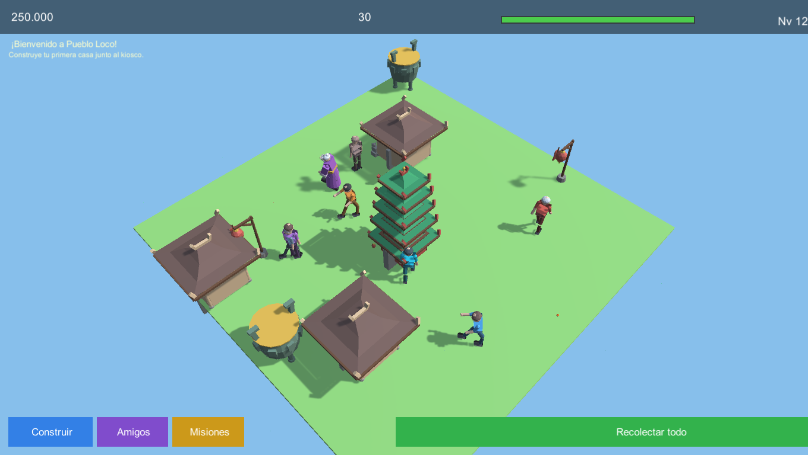

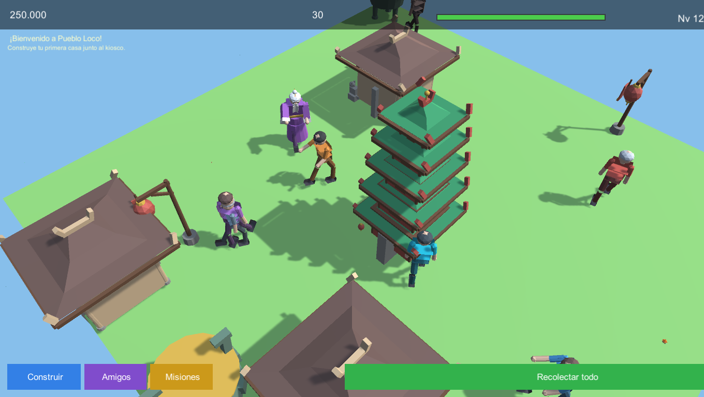

**Texturas CC0 y recursos libres**

- Texturas PBR de **Poly Haven** (licencia **CC0**, uso libre sin atribución):
  `grey_roof_tiles` (tejas), `clay_plaster` (muros de cal), `dark_wood` (madera) y
  `cobblestone_01` (piedra). Descargadas en 1K; las `_nor` se importan como *NormalMap*.
- Los modelos se exportan con **UV unwrap (smart project)** para que las texturas se vean bien.
- `GridBuildSystem` asigna difusa + normal map por nombre de material
  (roof / wood / stone / wall) y conserva los colores del catálogo como tinte sutil.
- Fuentes de assets libres investigadas: [Poly Haven](https://polyhaven.com) (CC0),
  [ambientCG](https://ambientcg.com) (CC0), [Kenney](https://kenney.nl) (CC0),
  [Quaternius](https://quaternius.com) (CC0) y [OpenGameArt](https://opengameart.org).

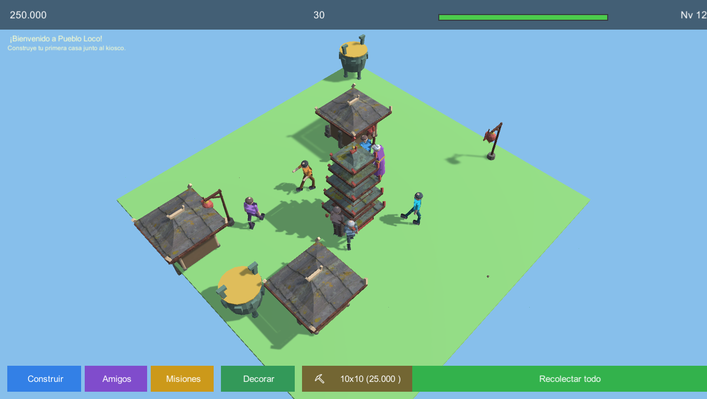

### Tipologías nuevas y rig Humanoid (v3)

**Edificios nuevos** (Blender → catálogo → juego):

| Tipología | Asset | En el juego |
|---|---|---|
| Mercado | `SM_Building_Market` | **Mercado del Barrio** (1.500) |
| Templo | `SM_Building_Temple` | **Templo Taoísta** (9.000) |
| Muralla | `SM_Building_Wall` | **Muralla** (2.500) |

- El mercado suma toldo de lona, dos puestos con mercancía, cajas, vasija y farolillos.
- El templo tiene escalinata, altar con incensario, doble techo y banderolas.
- La muralla trae almenas, camino de ronda y puerta con hoja de madera.
- Escalas visuales por tipología para que entren en la grilla de 1 m.

**Rig Humanoid**

- `SK_Sabio` y `SK_Guardia` se importan como **Humanoid** (`avatar = válido`, 22 huesos,
  8 clips) y el juego lo verifica en tiempo de ejecución (`animators=10, humanoides=2`).
- `Villager`, `Kid` y `Elder` siguen en rig **Generic** (sin cambios).
- Con Humanoid los personajes chinos quedan listos para retargetear animaciones de
  Mixamo o del [Universal Animation Library](https://store.godotengine.org/asset/quaternius/universal-animation-library/).

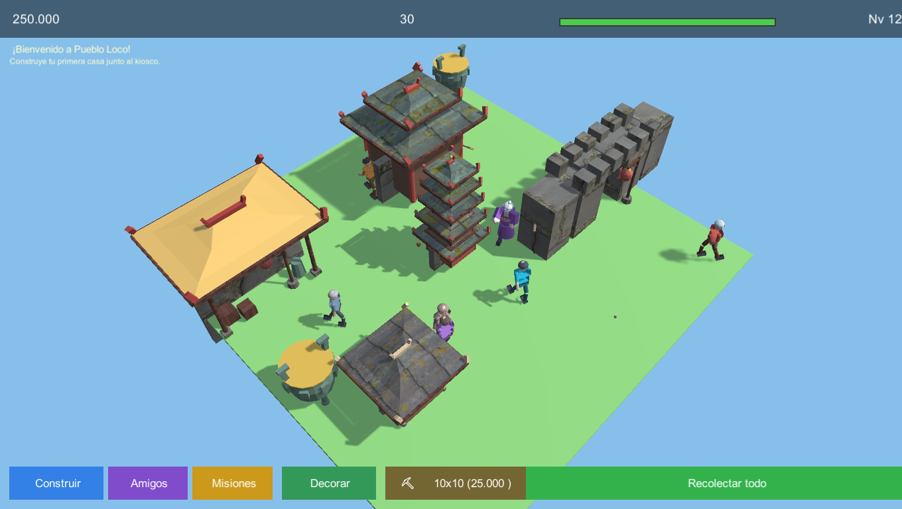

| Mercado | Templo | Muralla |
|---|---|---|
| 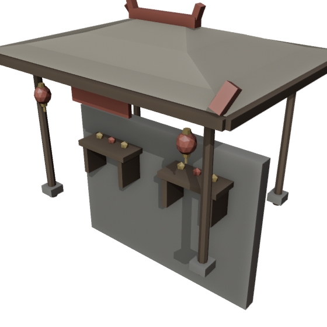 | 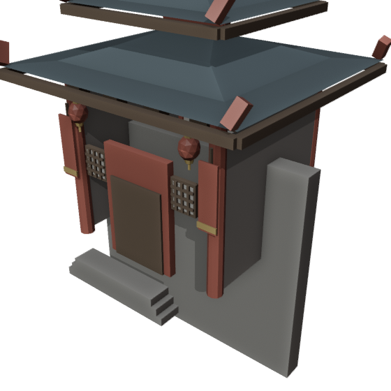 | 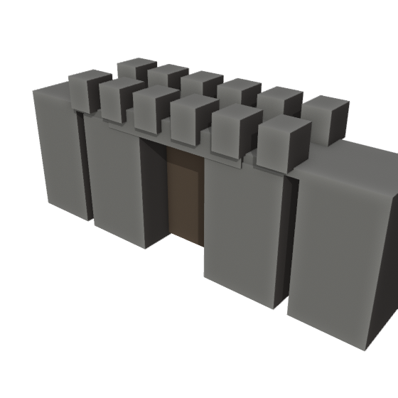 |

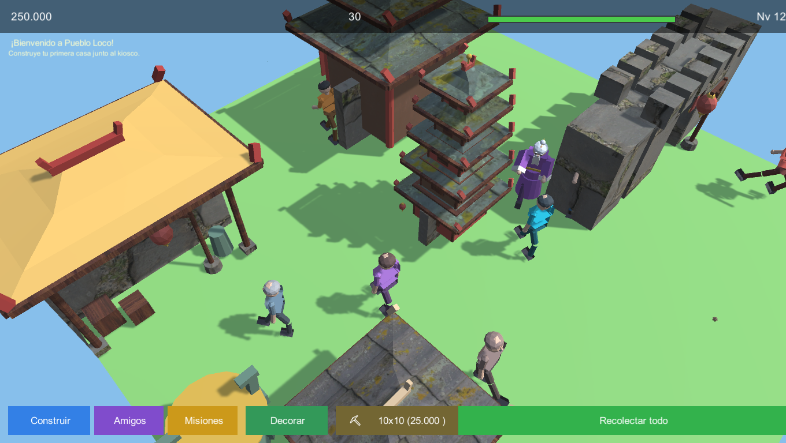

### Correcciones del proyecto original

- **Terreno y edificios acostados**: los FBX traen una rotación de -90° en la raíz que
  `Instantiate(..., Quaternion.identity)` borraba. Ahora se conserva y el pueblo se ve derecho.
- **Edificios con cubo de reemplazo**: se cargaban con minúscula (`"casa"`) y los FBX se llaman
  `Casa.fbx`; ahora se mapean bien y aparecen los modelos reales.
- **Sobre-exposición**: se bajó la luz solar y el ambiente, y se activaron sombras suaves.
- **HUD superpuesto**: la barra de XP y el texto de nivel se pisaban, y la misión tapaba el
  panel superior. Reubicados.
- **Aparición de edificios** con animación de rebote (PopIn).

## Cómo jugar

| Acción | Control |
|---|---|
| Mover cámara | `WASD` / flechas (o arrastrar con un dedo) |
| Zoom | rueda del mouse / pinza de dos dedos |
| Construir | botón **Construir** → elegir edificio → click en el terreno |
| Recolectar | click en la burbuja de monedas de cada edificio, o **Recolectar todo** |
| Amigos / tareas | botón **Amigos** (o click sobre un vecino) |
| Misiones | botón **Misiones** |

## Cómo abrir el proyecto

1. Abrir esta carpeta con **Unity 6000.6.5f1** (Unity Hub → Add project).
2. Abrir `Assets/Scenes/Main.unity` y darle Play.
   La escena puede estar vacía: todo se construye por código desde `Bootstrap`.

Build de Windows (batch):

```powershell
& "C:\Program Files\Unity\Hub\Editor\6000.6.5f1\Editor\Unity.exe" `
  -batchmode -projectPath "C:\ruta\pueblo-loco-unity" `
  -executeMethod PuebloLoco.EditorTools.CharacterPipeline.BuildCI `
  -logFile build.log
```

El ejecutable queda en `Build/PuebloLoco.exe`.

## Pipeline de arte (Blender)

Los personajes se generan **100% por código** con Blender headless:

```powershell
& "tools\blender-5.2.2-windows-x64\blender.exe" --background --factory-startup --offline-mode `
  --python "Tools\Blender\build_characters.py"
```

El script construye malla + armature + skinning + las 5 animaciones, exporta los FBX a
`Assets/Resources/Characters/` y renderiza previews de control en `Tools/Blender/previews/`.

> Nota: Blender escribe en `pueblo_stage/` (staging) porque en esta máquina corre con
> permisos restringidos; después se copian los FBX al proyecto.

## Estructura

```
Assets/
  Art/Characters/            FBX originales de los personajes
  Resources/Characters/      FBX que carga el juego en runtime
  Resources/Animations/      Animator Controllers generados
  Scripts/
    Gameplay/VillagerAI.cs      comportamiento de los vecinos
    Gameplay/VillagerManager.cs spawn + pintado + animator
    Gameplay/CharacterView.cs   click → saludo + menú Amigos
    Gameplay/GridBuildSystem.cs grilla, edificios, tintes
    Dev/DevCapture.cs           modo capturas (-shotdir)
  Editor/CharacterPipeline.cs import settings + controllers + build
Tools/Blender/build_characters.py   generador de personajes
docs/                               capturas para el README
```

### Modo captura

```
Build\PuebloLoco.exe -shotdir "C:\ruta\shots" -screen-width 1360 -screen-height 768
```

Arma un pueblo de ejemplo, deja a los vecinos animados y guarda 6 PNGs.

## Créditos

- Juego original (web): [traderxael/pueblo-loco](https://github.com/traderxael/pueblo-loco)
- Personajes, esqueletos y animaciones: generados con Blender 5.2.2 (script incluido)
- Motor: Unity 6000.6.5f1
