# Pueblo Loco (Unity)

Versión **Unity 3D** de [Pueblo Loco](https://github.com/traderxael/pueblo-loco): un juego
de construcción de barrio con vecinos, tareas, misiones y monedas.

Esta versión suma **personajes con esqueleto y animaciones hechas en Blender**, vecinos que
caminan solos por el pueblo y varias correcciones de render del proyecto original.


## Novedades de esta versión

### Personajes con esqueleto y animaciones (Blender)

- 3 modelos riggeados generados por script en Blender: **Villager** (adulto), **Kid** (nene)
  y **Elder** (abuelo).
- Cada uno con **armature de 20 huesos** (raíz, caderas, columna, pecho, cuello, cabeza,
  hombros, brazos con codo, manos, piernas con rodilla y pies) y *skinning* rígido por partes.
- **5 animaciones por personaje**, exportadas en el mismo FBX como takes separados:
  `Idle`, `Walk`, `Run`, `Work`, `Wave`.

| Idle | Walk | Work | Wave |
|---|---|---|---|
|  |  |  |  |

- **VillagerManager** instancia a todos los vecinos desbloqueados y les pinta ropa/pelo/piel
  con los colores del catálogo (cada personaje se ve distinto).
- **VillagerAI**: máquina de estados Idle → Walk → Work que camina por el terreno libre,
  esquiva edificios, va a trabajar cuando tiene una tarea activa y saluda si lo tocás.
- **Animator Controllers** generados por editor script con parámetros `Speed`, `Working` y
  `Wave` y transiciones Idle/Walk/Run/Work/Wave.

### Tema "China antigua" (Canva → Blender → Unity)

A partir de la presentación sobre las dinastías Xia, Shang y Zhou hecha en **Canva**
(carpeta `pueblo loco`), se modelaron los assets en Blender y se integraron al juego.

**Rediseño v2** (siguiendo el prompt maestro de ciudad china, estilo Tang/Ming):

- Paleta del prompt: rojo laca `#B33B2E`, dorado `#D9A441`, verde jade `#3E7C59`,
  madera oscura `#4A3728`, techo azul-gris `#37474F` y blanco cal `#EDE6D6`.
- **Techos** con perfil curvo, aleros levantados, tabla de alero, caballete y remates.
- **Dougong** (ménsulas entrelazadas) bajo cada alero.
- **Celosías geométricas** en puertas y ventanas, studs dorados, farolillos,
  banderolas y **leones guardianes** en la entrada.
- **Pagoda de 5 pisos** con balcones, barandas, pináculo de aros dorados y farolillos.
- **Paifang** (puerta ceremonial) con tres techos y banderolas.
- Assets con nomenclatura **SM_/SK_** e `index.json` con tris, huesos y animaciones
  (`docs/assets-china-index.json`).

| Casa Han | Pagoda 5 pisos | Paifang |
|---|---|---|
|  |  |  |

| Vasija ding | Farol | Sabio Chen | Guardia Wu |
|---|---|---|---|
|  |  |  |  |

**Personajes** (`SK_Sabio`, `SK_Guardia`):

- **22 huesos con nombres del rig Humanoid de Unity** (`Hips`, `Spine`, `Chest`,
  `Head`, `LeftUpperArm`, `LeftLowerLeg`, `LeftToes`, ...), listos para mapear a
  avatar Humanoid.
- **8 animaciones** cada uno: `Idle`, `Walk`, `Run`, `Work`, `Wave`, `Bow`, `Cheer`, `Gather`.
- Sabio: túnica en capas, solapas cruzadas, faja con jade, rodete con pasador y barba.
- Guardia: armadura lamelar, hombreras, casco con cresta, grebas y lanza con moharra y borla.

**Integración en el juego**

- Edificios nuevos: **Casa Han** (900) y **Pagoda del Dragón** (6000); el paifang está
  disponible como asset para futuras puertas de distrito.
- Vecinos nuevos desbloqueables con tareas propias: "Estudiar los clásicos",
  "Meditar en el jardín", "Patrullar el pueblo" y "Entrenar con la lanza".
- Decoración: faroles y vasijas de bronce colocables.
- Las partidas viejas **migran solas** (`SaveSystem.EnsureCharacters`).


**Texturas CC0 y recursos libres**

- Texturas PBR de **Poly Haven** (licencia **CC0**, uso libre sin atribución):
  `grey_roof_tiles` (tejas), `clay_plaster` (muros de cal), `dark_wood` (madera) y
  `cobblestone_01` (piedra). Descargadas en 1K; las `_nor` se importan como *NormalMap*.
- Los modelos se exportan con **UV unwrap (smart project)** para que las texturas se vean bien.
- `GridBuildSystem` asigna difusa + normal map por nombre de material
  (roof / wood / stone / wall) y conserva los colores del catálogo como tinte sutil.
- Fuentes de assets libres investigadas: [Poly Haven](https://polyhaven.com) (CC0),
  [ambientCG](https://ambientcg.com) (CC0), [Kenney](https://kenney.nl) (CC0),
  [Quaternius](https://quaternius.com) (CC0) y [OpenGameArt](https://opengameart.org).


### Tipologías nuevas y rig Humanoid (v3)

**Edificios nuevos** (Blender → catálogo → juego):

| Tipología | Asset | En el juego |
|---|---|---|
| Mercado | `SM_Building_Market` | **Mercado del Barrio** (1.500) |
| Templo | `SM_Building_Temple` | **Templo Taoísta** (9.000) |
| Muralla | `SM_Building_Wall` | **Muralla** (2.500) |

- El mercado suma toldo de lona, dos puestos con mercancía, cajas, vasija y farolillos.
- El templo tiene escalinata, altar con incensario, doble techo y banderolas.
- La muralla trae almenas, camino de ronda y puerta con hoja de madera.
- Escalas visuales por tipología para que entren en la grilla de 1 m.

**Rig Humanoid**

- `SK_Sabio` y `SK_Guardia` se importan como **Humanoid** (`avatar = válido`, 22 huesos,
  8 clips) y el juego lo verifica en tiempo de ejecución (`animators=10, humanoides=2`).
- `Villager`, `Kid` y `Elder` siguen en rig **Generic** (sin cambios).
- Con Humanoid los personajes chinos quedan listos para retargetear animaciones de
  Mixamo o del [Universal Animation Library](https://store.godotengine.org/asset/quaternius/universal-animation-library/).


| Mercado | Templo | Muralla |
|---|---|---|
|  |  |  |


### Contenido adicional (v4): más edificios y vecinos

Generado con `Tools/Blender/build_china_assets_v3.py` (reutiliza los helpers de la v2):

| Asset | En el juego | Detalle |
|---|---|---|
| `SM_Building_Blacksmith` | **Herrería** (2.200) | Fragua con **brasas emisivas**, chimenea, yunque, herramientas |
| `SM_Building_Farm` | **Granja de Arroz** (1.100) | Terrazas con agua, hileras de arroz, cabaña de paja y cerco |
| `SM_Building_Inn` | **Posada** (4.000) | Dos plantas, balcón con baranda, cartel y faroles |
| `SM_Building_BellTower` | **Campanario** (7.000) | Campana de bronce, vigas y techo curvo |
| `SM_Prop_Well` | decoración | Pozo de piedra con techo de paja y balde |
| `SK_Merchant` | **Comerciante Wen** (15 donas) | Túnica, delantal, sombrero y bolsa; tareas "Atender el mercado" / "Negociar" |
| `SK_Farmer` | **Campesino Li** (15 donas) | Sombrero de paja y caña con cestas; tareas "Sembrar arroz" / "Cosechar" |

- Total del paquete: **17 assets** (10 modelos de arquitectura/props + 4 personajes
  Humanoid + 3 personajes Generic), inventariados en `docs/assets-china-index.json`.
- Las brasas de la fragua usan **emisión** (`_EMISSION`) en Unity para que brillen.
- Los vecinos nuevos aparecen solos en partidas viejas (`EnsureCharacters`).

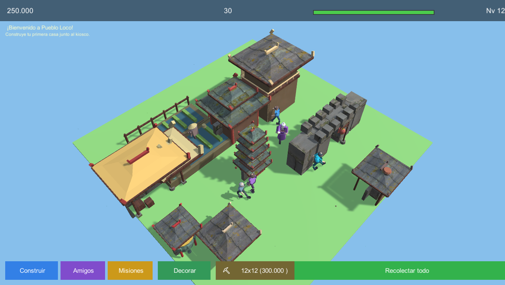

| Herrería | Granja | Posada | Campanario |
|---|---|---|---|
| 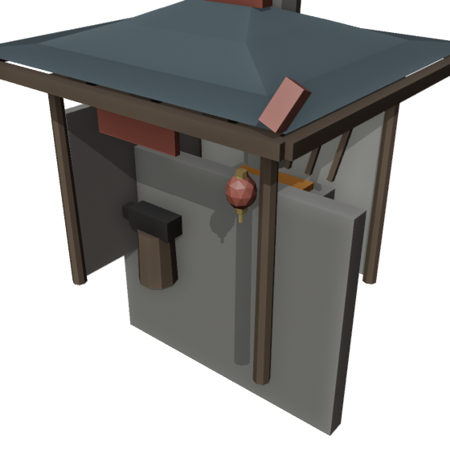 | 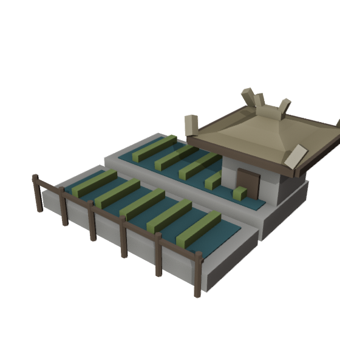 | 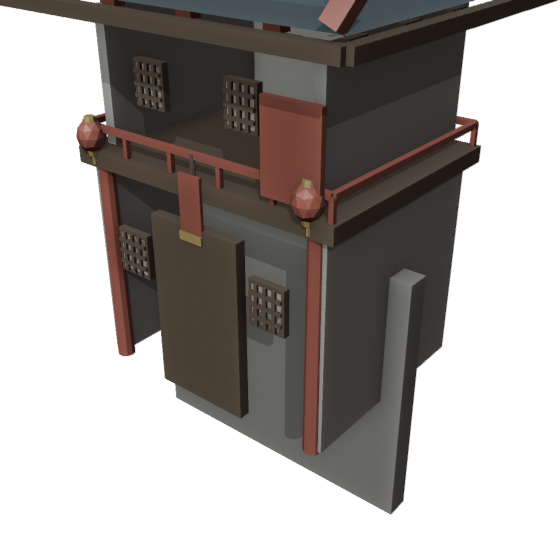 | 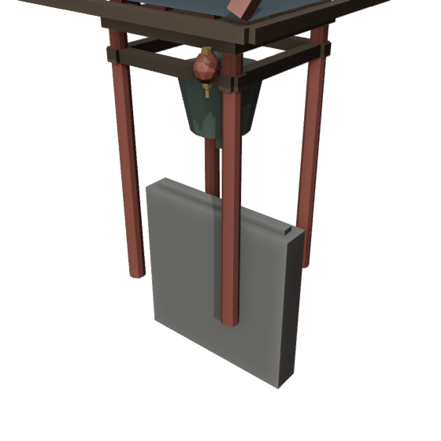 |

| Pozo | Comerciante Wen | Campesino Li |
|---|---|---|
| 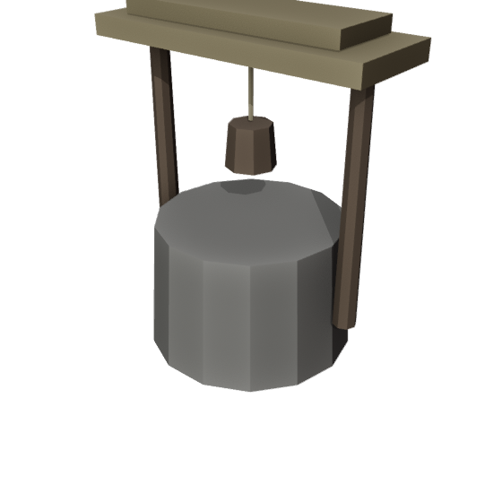 | 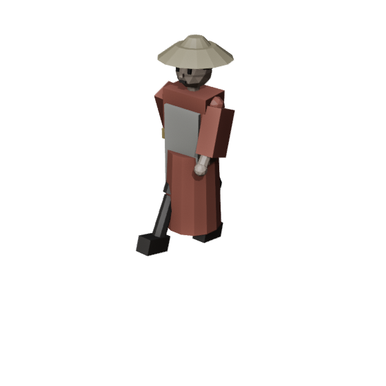 | 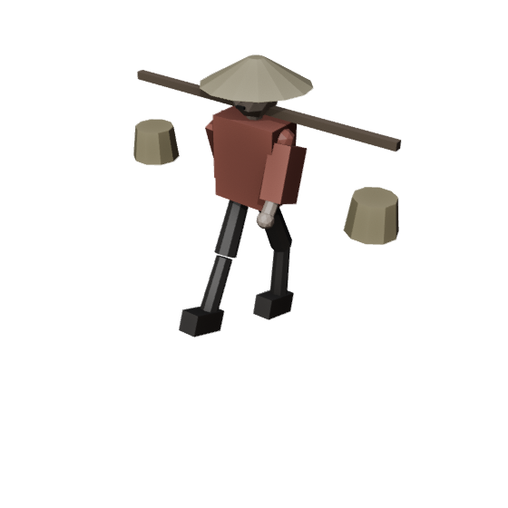 |

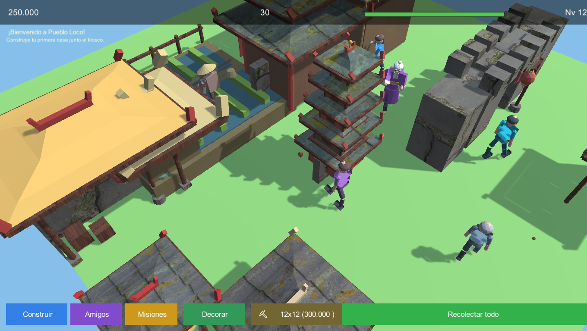

### Más territorio (v5): el valle crece

Se amplió la progresión de terreno de 4 a **8 niveles** (de 6×6 a 20×20):

| Nivel | Tamaño | Costo |
|---|---|---|
| 0 | 6×6 | gratis |
| 1 | 8×8 | 2.000 |
| 2 | 10×10 | 25.000 |
| 3 | 12×12 | 300.000 |
| 4 | **14×14** | 1.800.000 |
| 5 | **16×16** | 7.000.000 |
| 6 | **18×18** | 25.000.000 |
| 7 | **20×20** | 80.000.000 |

- **Logros nuevos**: "Conquistador" (14×14, 40 donas) y "Emperador del valle" (20×20, 150 donas).
- **Cámara**: el zoom máximo ahora es dinámico (`size * 1.3 + 5`, hasta ~31 m) para poder ver
  todo el valle; antes estaba fijo en 15 m y no se veía el mapa grande.
- Los árboles del borde, el paseo de los vecinos y la colocación de edificios ya escalaban con
  el tamaño del terreno, así que funcionan solos con los niveles nuevos.
- El botón del HUD muestra automáticamente el próximo tamaño y costo, y "Terreno máximo" al llegar al final.

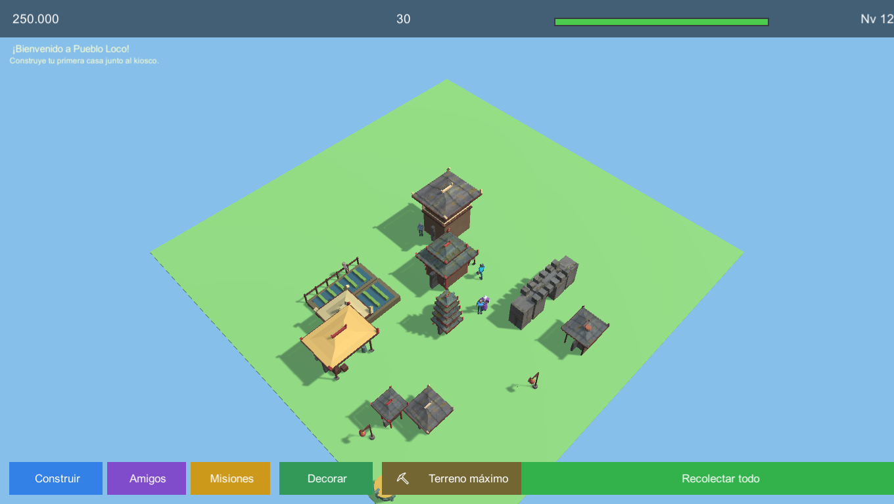

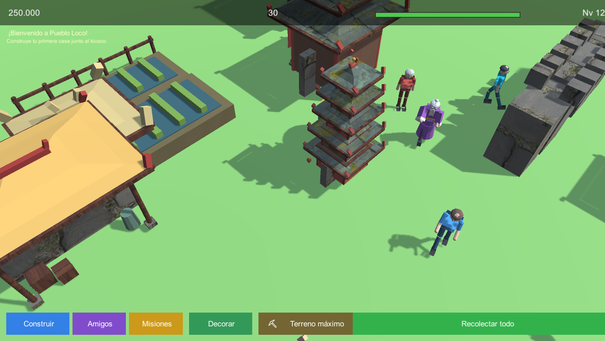

### Río, puente y montañas (v6)

Generado con `Tools/Blender/build_china_assets_v4.py`:

| Asset | Uso |
|---|---|
| `SM_Env_River` | Segmento de río de 8x8 m con orillas de piedra, juncos y rocas |
| `SM_Env_Bridge` | Puente de arco de piedra con barandas rojas |
| `SM_Env_Mountain` | Grupo de montañas low-poly con nieve para el fondo |

- `GridBuildSystem.BuildEnvironment` arma el entorno por código: **12 montañas en anillo**
  alrededor del valle, **7 segmentos de río** al norte y el **puente** cruzándolo.
- El entorno **se regenera al ampliar el terreno** (el anillo se aleja según el tamaño).
- **Misiones nuevas** con objetivo `land`: q13 "El valle se extiende" (14x14) y
  q14 "Emperador del valle" (20x20).
- El proyecto ahora corre sobre **URP**; los materiales usan el shader URP Lit con
  fallback y `Assets/Resources/URPLit.mat` evita que el shader se stripea en el build.

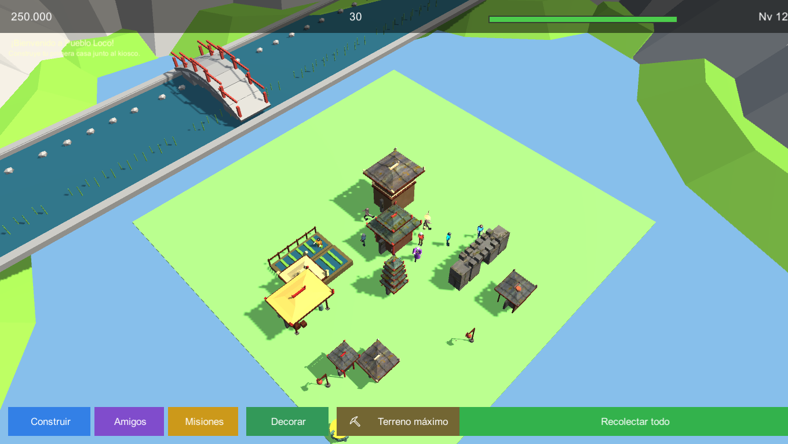

| Río | Puente | Montañas |
|---|---|---|
| 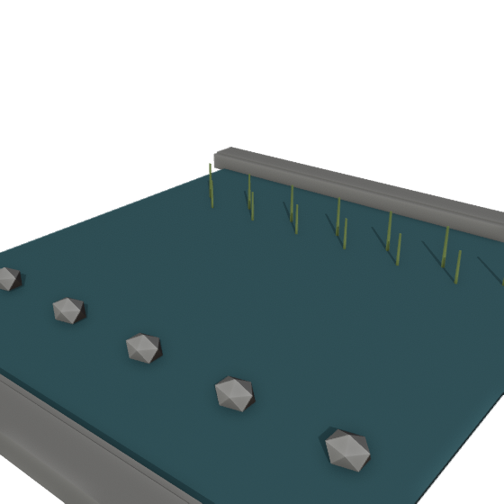 | 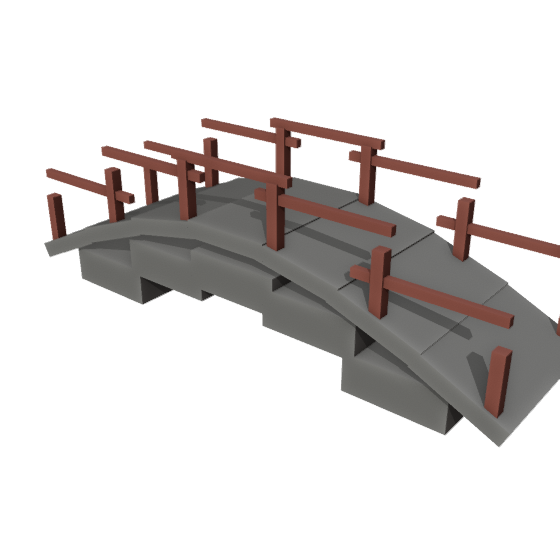 | 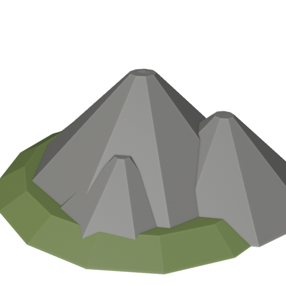 |

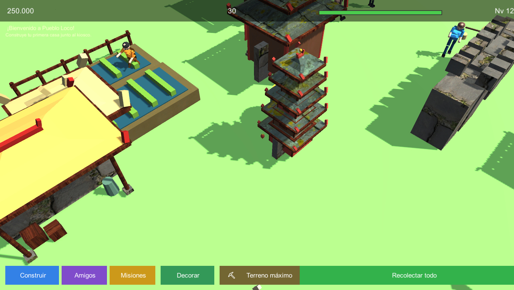
### Correcciones del proyecto original

- **Terreno y edificios acostados**: los FBX traen una rotación de -90° en la raíz que
  `Instantiate(..., Quaternion.identity)` borraba. Ahora se conserva y el pueblo se ve derecho.
- **Edificios con cubo de reemplazo**: se cargaban con minúscula (`"casa"`) y los FBX se llaman
  `Casa.fbx`; ahora se mapean bien y aparecen los modelos reales.
- **Sobre-exposición**: se bajó la luz solar y el ambiente, y se activaron sombras suaves.
- **HUD superpuesto**: la barra de XP y el texto de nivel se pisaban, y la misión tapaba el
  panel superior. Reubicados.
- **Aparición de edificios** con animación de rebote (PopIn).


### Personaje 3D descargado: Guerrero Ko (v7)

Modelo real de la comunidad en vez de generado por script:

- **Samurai lowpoly con animaciones** por [null-painter-error](https://opengameart.org/content/3d-lowpoly-samurai-with-animations-fbx-format)
  (OpenGameArt, **CC-BY 4.0**).
- 21 huesos (rig generico), textura propia (`samutex.png`) y 5 clips:
  `idle`, `walk`, `attack`, `damage`, `die`.
- Se mapean al esquema del juego: `idle -> Idle`, `walk -> Walk`,
  `attack -> Work` (trabaja entrenando con la katana), `damage -> Wave`.
- Integrado como **Guerrero Ko** (35 donas) con tareas "Entrenar con la
  katana" y "Ronda de guardia"; el tinte respeta su textura original.

### Calle estilo Frostpunk + 3 modelos descargados (v8)

**Camino de piedra** (`SM_Prop_Street`, generado por script): losas de piedra con
bordes y dos faroles rojos — el look de senderos de Frostpunk con tema chino.
Encastra en la grilla de decor (1x1) para unir edificios con la pagoda.

**Modelos reales de OpenGameArt** (convertidos de .blend a FBX con Blender):

| Asset | Fuente | Licencia | En el juego |
|---|---|---|---|
| `SM_Prop_Gong` | [China Gong](https://opengameart.org/content/chinagong) | CC0 | **Gong del templo** (4.000, Nv 5) |
| `SM_Prop_Cart` | [Chinese Food Cart](https://opengameart.org/content/chinese-food-cart) | CC-BY 3.0 | **Carrito de comida** (900, Nv 3) |
| `SM_Prop_Dragon` | [Flying Dragon](https://opengameart.org/content/flying-dragon) | CC0 | **Dragon de jade** (15.000, Nv 7) |

- El **dragon chino dorado** (13 meshes, 44 huesos, 7 clips) VUELA: controller con
  todos los clips en loop, default `DragonFlying1`, escala 5.5 (~3 m) elevado
  sobre la plaza. Sus texturas son normal maps; el color dorado viene del material.
- El carrito conserva sus 3 texturas originales (cuerpo, techo y ruedas).
- Las escalas se calibraron con una sonda del ModelImporter (el .blend del dragon
  venia normalizado a 0.55 u; con escala 0.10 quedaba invisible de 5 cm).

### UI estilo city-builder (v9)

Rediseño de la interfaz al patron de los juegos de economia y administracion
de ciudad (Frostpunk / Cities: Skylines / Anno):

- **Barra de acciones inferior centrada**: Recolectar, Construir, Decorar,
  Amigos, Misiones y Ampliar terreno como botones uniformes (140-220 px)
  sobre una franja oscura translucida. Antes estaban apilados con offsets
  absolutos en la esquina inferior izquierda.
- **Boton de terreno compacto**: formato de costo tipo city-builder
  (`14x14 . 1.8M` en vez de `(1.800.000)`).
- **Construir y Decorar como gavetas inferiores**: panel de ancho completo
  (100-560 px sobre la barra) con **grilla de tarjetas** de 330x84 en vez
  de lista lateral. Los 21 edificios quedan en 5 columnas con scroll.
- Recursos (monedas, donas, nivel + barra XP) permanecen en la franja superior.

### Pulido de UI v10: tooltips, iconos y animacion

- **Tooltips estilo city-builder**: nueva clase `Tooltip` que sigue el cursor al
  pasar el mouse sobre las tarjetas. Muestra produccion ("Produce 8 🪙 cada 30s ·
  +10 XP"), costo, nivel, tamano, y aviso en rojo si faltan monedas. Se ubica a la
  derecha-arriba del cursor y se invierte en los bordes.
- **Icono por edificio/adorno** en cada tarjeta (🏠 🥖 🛕 🌾 ⛔ ... 🗿 🐉) con
  rich text (`<size=32>` para el icono).
- **Colores de estado**: costo en dorado, rojo si no alcanza, naranja si esta
  bloqueado, y gris azulado para el tamano.
- **Realce al pasar el mouse**: la tarjeta se ilumina (color x1.35).
- **Animacion de gaveta**: Construir y Decorar suben desde abajo con easing
  easeOutCubic (0.22 s) en vez de aparecer de golpe.
## Cómo jugar

| Acción | Control |
|---|---|
| Mover cámara | `WASD` / flechas (o arrastrar con un dedo) |
| Zoom | rueda del mouse / pinza de dos dedos |
| Construir | botón **Construir** → elegir edificio → click en el terreno |
| Recolectar | click en la burbuja de monedas de cada edificio, o **Recolectar todo** |
| Amigos / tareas | botón **Amigos** (o click sobre un vecino) |
| Misiones | botón **Misiones** |

## Cómo abrir el proyecto

1. Abrir esta carpeta con **Unity 6000.6.5f1** (Unity Hub → Add project).
2. Abrir `Assets/Scenes/Main.unity` y darle Play.
   La escena puede estar vacía: todo se construye por código desde `Bootstrap`.

Build de Windows (batch):

```powershell
& "C:\Program Files\Unity\Hub\Editor\6000.6.5f1\Editor\Unity.exe" `
  -batchmode -projectPath "C:\ruta\pueblo-loco-unity" `
  -executeMethod PuebloLoco.EditorTools.CharacterPipeline.BuildCI `
  -logFile build.log
```

El ejecutable queda en `Build/PuebloLoco.exe`.

## Pipeline de arte (Blender)

Los personajes se generan **100% por código** con Blender headless:

```powershell
& "tools\blender-5.2.2-windows-x64\blender.exe" --background --factory-startup --offline-mode `
  --python "Tools\Blender\build_characters.py"
```

El script construye malla + armature + skinning + las 5 animaciones, exporta los FBX a
`Assets/Resources/Characters/` y renderiza previews de control en `Tools/Blender/previews/`.

> Nota: Blender escribe en `pueblo_stage/` (staging) porque en esta máquina corre con
> permisos restringidos; después se copian los FBX al proyecto.

## Estructura

```
Assets/
  Art/Characters/            FBX originales de los personajes
  Resources/Characters/      FBX que carga el juego en runtime
  Resources/Animations/      Animator Controllers generados
  Scripts/
    Gameplay/VillagerAI.cs      comportamiento de los vecinos
    Gameplay/VillagerManager.cs spawn + pintado + animator
    Gameplay/CharacterView.cs   click → saludo + menú Amigos
    Gameplay/GridBuildSystem.cs grilla, edificios, tintes
    Dev/DevCapture.cs           modo capturas (-shotdir)
  Editor/CharacterPipeline.cs import settings + controllers + build
Tools/Blender/build_characters.py   generador de personajes
docs/                               capturas para el README
```

### Modo captura

```
Build\PuebloLoco.exe -shotdir "C:\ruta\shots" -screen-width 1360 -screen-height 768
```

Arma un pueblo de ejemplo, deja a los vecinos animados y guarda 6 PNGs.

## Créditos

- Juego original (web): [traderxael/pueblo-loco](https://github.com/traderxael/pueblo-loco)
- Personajes, esqueletos y animaciones: generados con Blender 5.2.2 (script incluido)
- Motor: Unity 6000.6.5f1
